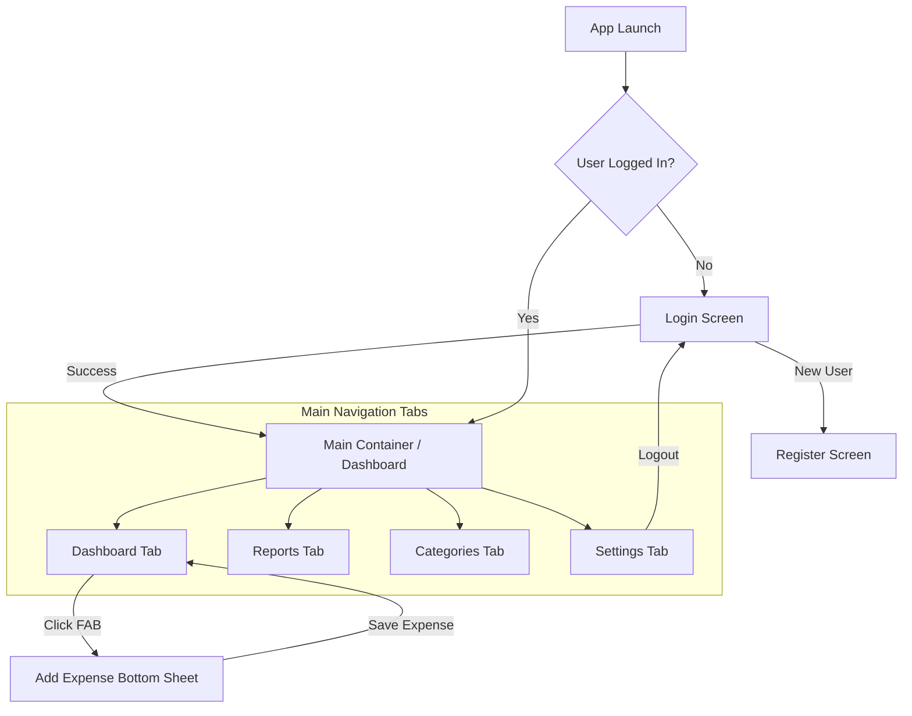

# 📊 CashFlow Expense Tracker — Group Presentation & Project Documentation

<p align="center">
  
</p>

<p align="center">
  
  
  
  
  
  
  
</p>

---
## 👥 Developers & Team Members
* **Lead Developer / System Architect:** John Mark Santos
* **Group Mates:**
* Jana Ann Alcoriza
* Maria Arliene De Jesus
* Mecy Balana
* Chelsea Claire Gabriel

* **Institution:** Bulacan Polytechnic College (BPC)
* **Program/Section:** Associate in Computer Technology / ACT 2A

---

## 📑 Table of Contents
1. [Presentation Title & Project Overview](#1-presentation-title--project-overview)
2. [Problem Statement & Objectives](#2-problem-statement--objectives)
3. [App Flow & Architecture](#3-app-flow--architecture)
4. [Key Features & Visual Highlights](#4-key-features--visual-highlights)
5. [Group Presentation Talking Points / Slides Breakdown](#5-group-presentation-talking-points--slides-breakdown)
6. [Setup & Execution Guide](#6-setup--execution-guide)

---

## 1. Presentation Title & Project Overview

### **Presentation Title:**
> **CashFlow: Smart Personal Finance & Expense Tracker for Android**
> *Empowering Financial Literacy and Daily Budget Control through Modern Mobile Architecture*

### **Project Overview:**
**CashFlow Expense Tracker** is a feature-rich, high-performance native Android application engineered using **Jetpack Compose**, **Kotlin**, and the **MVVM architecture pattern**. Designed specifically for everyday users and students in the Philippines, CashFlow integrates native **Philippine Peso (`₱`) currency formatting**, secure local authentication, persistent SQLite storage via **Room**, interactive spending analytics, and dynamic category management. 

Adhering strictly to **Google's Material Design 3 (M3)** guidelines, the application delivers an expressive, accessible, and responsive user experience across diverse Android form factors.

---

## 2. Problem Statement & Objectives

### **Problem Statement:**
1. **Lack of Budget Visibility:** Many individuals struggle to monitor daily discretionary spending, leading to unplanned debt and financial stress.
2. **Complex & Privacy-Risks Apps:** Existing budgeting solutions often require intrusive cloud accounts, paid subscriptions, or expose sensitive financial data to third-party servers.
3. **Currency & Localization Gaps:** Generic expense apps lack built-in localization for Philippine currency (`₱`) and regional spending categories.

### **Project Objectives:**
* **Offline-First Security:** Provide a fully functional, local-first expense tracker where user data remains secure on the device using Room SQLite database.
* **Intuitive UI/UX:** Build a modern, elegant interface using Jetpack Compose and Material 3 with smooth state transitions and adaptive layouts.
* **Comprehensive Analytics:** Deliver real-time visual summaries, monthly statistics, and top spending category rankings formatted in Philippine Peso (`₱`).
* **Seamless Navigation:** Implement a robust navigation flow supporting authentication sessions, dashboard summaries, quick expense entry, category customization, and user settings.

---

## 3. App Flow & Architecture

### **Application Navigation & Screen Flow**


### **MVVM + Clean Repository Architecture**
CashFlow follows the industry-standard **Model-View-ViewModel (MVVM)** architectural pattern combined with the **Repository Pattern** to achieve separation of concerns, testability, and reactive state management.

```mermaid
graph LR
    UI[Jetpack Compose UI<br/>(Screens & Bottom Sheets)] -->|User Actions & State Flow| VM[ViewModels<br/>(DashboardViewModel, AuthViewModel, etc.)]
    VM -->|Coroutines & Suspend Functions| Repo[Repositories<br/>(ExpenseRepository, AuthRepository, CategoryRepository)]
    Repo -->|Data Queries| DAO[Room DAOs<br/>(ExpenseDao, UserDao, CategoryDao)]
    DAO -->|SQLite Operations| DB[(Room AppDatabase)]
```

* **Model:** Room Entities (`ExpenseEntity`, `UserEntity`, `CategoryEntity`) and local DataStores.
* **View (UI):** Declarative Jetpack Compose screens (`DashboardScreen`, `ReportsScreen`, `CategoriesScreen`, `SettingsScreen`) observing UI state via Kotlin `StateFlow`.
* **ViewModel:** Handles business logic, state emission (`MutableStateFlow`), database operations via repositories, and survives configuration changes.
* **Repository:** Acts as a single source of truth, abstracting data sources (Room DAOs and Preferences).

---

## 4. Key Features & Visual Highlights

### **1. 🔐 Secure Authentication & Session Management**
* **Login & Registration Screens:** Form-validated authentication screens with instant feedback and secure credential verification against local SQLite storage.
* **Persistent Sessions:** Remembers user login state across app restarts, redirecting straight to the dashboard.

### **2. 📊 Interactive Dashboard (`₱` Currency)**
* **Financial Overview Cards:** Instant display of total expenses, monthly totals, and recent transaction history.
* **Philippine Peso (`₱`) Localization:** Uniform currency formatting across all summary cards, lists, and charts (`₱1,500.00`).
* **Quick Expense Logging (FAB):** Floating Action Button triggering a responsive modal bottom sheet for instant expense entry.

### **3. 📝 Expense Logging & Management**
* **Detailed Entry Form:** Input fields for amount (`₱`), category selection, date picker, and optional transaction notes.
* **Real-Time Updates:** Instant UI reflection using Kotlin `StateFlow` and Room reactive queries upon adding or deleting expenses.

### **4. 🏷️ Categories Management**
* **Pre-Populated & Custom Categories:** Comes equipped with standard categories (Food, Transport, Utilities, Entertainment, Shopping) featuring custom icons and color tags.
* **Category Creation:** Users can add custom categories tailored to their personal budgeting requirements.

### **5. 📈 Expense Reports & Analytics**
* **Visual Breakdown Charts:** Graphical representation of spending distribution across various categories.
* **Top Categories Ranking:** Highlights top spending areas to help users identify and curb unnecessary expenses.

### **6. ⚙️ Settings & Customization**
* **Profile & Account Details:** View active user session information and manage app preferences.
* **Theme Customization:** Support for dynamic system colors and light/dark theme adaptation.

---

## 5. Group Presentation Talking Points / Slides Breakdown

Use this structured slide-by-slide guide when presenting the project to instructors and peers:

### **Slide 1: Introduction & Project Vision**
* **Title:** CashFlow: Smart Personal Finance & Expense Tracker
* **Team Members / Presenters:** [Insert Team Names]
* **Key Talking Points:**
  - Introduce the everyday struggle of managing personal finances without proper tracking tools.
  - Present CashFlow as an offline-first, privacy-focused mobile application built specifically for Philippine users (`₱` currency).
  - Highlight the modern technology stack: Kotlin, Jetpack Compose, Material 3, and Room DB.

### **Slide 2: Problem Statement & Solution**
* **Problem:** Users lack visibility into daily cash outflow and face complicated budgeting apps with intrusive cloud dependencies.
* **Solution:** A lightweight, secure, local-first Android app providing instant spending summaries, category breakdowns, and zero setup friction.
* **Key Talking Points:**
  - Emphasize privacy: all data stays securely on the user's device.
  - Highlight localization: built-in Philippine Peso (`₱`) currency formatting and relatable financial categories.

### **Slide 3: Architecture & Tech Stack**
* **Architecture Diagram / Explanation:** MVVM Pattern + Repository Pattern + Room Database + Jetpack Compose.
* **Key Talking Points:**
  - Explain how Unidirectional Data Flow (UDF) using Kotlin `StateFlow` keeps the UI synchronized with database changes.
  - Discuss the modular project structure separating data models, DAOs, repositories, ViewModels, and Compose UI components.
  - Mention adherence to Google Material Design 3 guidelines and Edge-to-Edge UI support.

### **Slide 4: Core Features & Live Demo Walkthrough**
* **Feature Highlights:**
  1. Login & User Registration
  2. Dashboard with Total Expenses & `₱` Currency Summary
  3. Quick Expense Logging via Bottom Sheet
  4. Category Management & Analytics Reports with Charts
  5. Settings & Profile Management
* **Key Talking Points:**
  - Walk through the live app or recorded video demo.
  - Show how easy it is to log an expense in seconds and watch the dashboard update instantly.
  - Demonstrate the visual breakdown in the Reports tab.

### **Slide 5: Conclusion, Challenges & Future Scope**
* **Achievements:** Successfully delivered a fully reactive, offline-first Android app with robust architecture and polished M3 UI.
* **Challenges Overcome:** Managing reactive state flows with Room database queries, ensuring edge-to-edge layout compliance, and handling configuration changes gracefully via ViewModels.
* **Future Enhancements:** Cloud backup integration, export to CSV/PDF reports, monthly budget limits with push notifications, and biometric login authentication.

---

## 6. Setup & Execution Guide

### **Prerequisites**
* **Android Studio** (Koala, Ladybug, or newer).
* **Android SDK** (API Level 24 to 34+).
* **JDK 17** or higher.

### **Step 1: Clone or Open the Project**
1. Open Android Studio.
2. Select **Open** and navigate to the project root directory:
   ```bash
   /Users/geraldguillermo/Desktop/ACT1A_ExpensesTracker
   ```
3. Allow Gradle to sync and download necessary dependencies (`libs.versions.toml`).

### **Step 2: Build the Application**
Run the following Gradle command in your terminal to assemble the debug APK:
```bash
./gradlew :app:assembleDebug
```

### **Step 3: Run Tests**
To execute unit tests and verify repository and ViewModel logic:
```bash
./gradlew :app:testDebugUnitTest
```

To run instrumented UI tests (requires an active emulator or connected device):
```bash
./gradlew :app:connectedDebugAndroidTest
```

### **Step 4: Launch on Emulator / Device**
1. Start an Android Virtual Device (AVD) running API 26 or higher.
2. Click the **Run 'app'** (▶) button in Android Studio to deploy and launch CashFlow Expense Tracker.

---
*Developed with dedication for Android Development Course Presentation.*
